# NT547 - LAB 06 - BÁO CÁO

**MSSV:** 24521888  | **Họ tên:** Nguyễn Xuân Trung | **Lớp:** NT547.R11.ANTT
**Session code tự sinh:** SC-3319B7 | **Tên contract:** SavingsClub_1888
**Solidity / Slither:** 0.8.24 (`0.8.24+commit.e11b9ed9`) / 0.11.6 | **Ngày hoàn thành:** 20/11/2026
**URL GitHub repository:** https://github.com/Trung949/Lab06_24521888

Môi trường: WSL2 Ubuntu (Python 3.12.3, venv), `solc-select use 0.8.24`, `tools/preflight.py` báo OK cho python, git, slither, solc.
Baseline SHA-256 (từ `lab_identity.json`): `66c98c62e45bb32d240d276572bd2fd11e7bf6464eb996eec8c49a4dc753cd1a`.

Trước khi quét, mình chạy `tools/preflight.py` cùng `solc --version` và `slither --version` để xác nhận môi trường đúng phiên bản đề yêu cầu. Kết quả ở Hình 1: python, git, slither và solc đều được tìm thấy, solc là 0.8.24 và Slither là 0.11.6.

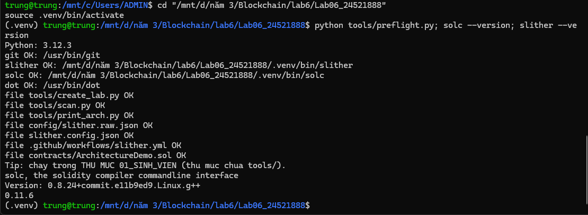

---

## 1. Static scan (2,0 điểm)

- Lệnh raw: `python tools/scan.py --mode raw --tag before`
- Số lượng finding raw từ `evidence/before_raw/summary.json` (tổng 14):
  - High: **2**; Medium: **3**; Low: **2**; Informational: **6**; Optimization: **1**
- Chạy configured: `python tools/scan.py --mode configured --tag before`, kết quả `evidence/before_configured/summary.json` (tổng 6):
  - High: **2**; Medium: **3**; Low: 0; Informational: 0; Optimization: 1
- So sánh raw/configured: `slither.config.json` chỉ bật `exclude_low`, `exclude_informational` và loại `solc-version`, nên 2 Low (`missing-zero-check`, `timestamp`) cùng 6 Informational (`low-level-calls` ×5, `naming-convention`) bị ẩn khỏi kết quả. **Toàn bộ 2 High và 3 Medium vẫn còn nguyên** ở cả hai chế độ: đổi config chỉ giảm nhiễu, không làm mất lỗi nghiêm trọng. Optimization (`constable-states`) không bị lọc vì config không đặt `exclude_optimization`.
- Có 5 detector High/Medium **khác tên**: `controlled-delegatecall`, `reentrancy-eth`, `tx-origin`, `unchecked-lowlevel`, `divide-before-multiply`.

| ID finding | Detector | Impact | Confidence | Source (file:dòng) | Luồng dữ liệu: đầu vào -> thao tác -> tác hại |
|---|---|---|---|---|---|
| F01 | controlled-delegatecall | High | Medium | AuditTarget.sol:`forward()` 51–54, lệnh ở dòng 52 | Bất kỳ ai truyền `target` và `data` tùy ý -> `delegatecall` chạy code của kẻ tấn công trong storage của SavingsClub -> ghi đè slot 0 (`owner`) hoặc chuyển toàn bộ ETH ra ngoài |
| F02 | reentrancy-eth | High | Medium | AuditTarget.sol:`claimSafe()` 66–71, call ở dòng 68, ghi state ở dòng 70 | Người gọi có `escrowed > 0` -> ETH được gửi trước, sau đó mới đặt `escrowed = 0` -> nếu không có khóa thì fallback có thể gọi lại để rút nhiều lần (thực tế bị modifier `guarded` chặn, xem mục 2) |
| F03 | tx-origin | Medium | Medium | AuditTarget.sol:`transferControl()` 56–60, dòng 57 | Owner bị dụ gọi vào một contract độc -> contract đó gọi `transferControl(attacker)` -> `tx.origin` vẫn là owner nên check đúng -> kẻ tấn công chiếm quyền owner |
| F04 | unchecked-lowlevel | Medium | Medium | AuditTarget.sol:`flush()` 46–49, dòng 48 | Owner gọi `flush(to)`, `to` là contract revert trong fallback -> `call` trả `false` nhưng bị bỏ qua -> giao dịch báo thành công, ETH không được chuyển, off-chain hiểu sai trạng thái |
| F05 | divide-before-multiply | Medium | Medium | AuditTarget.sol:`previewFee()` 73–75, dòng 74 | `amount` không chia hết 10000 -> `amount / 10000` bị làm tròn xuống trước khi nhân `feeBps` -> phí sai (ví dụ amount = 9999 thì phí = 0) |
| F06 | timestamp | Low | Medium | AuditTarget.sol:`vestStep()` 77–82, dòng 78 | Owner gọi `vestStep` -> so sánh với `block.timestamp` -> validator chỉ lệch được vài giây, không đáng kể với chu kỳ 1 ngày |
| F07 | missing-zero-check | Low | Medium | AuditTarget.sol:`forward()` 51, dòng 52 | `target = address(0)` -> `delegatecall` tới địa chỉ rỗng (bị xử lý luôn khi xóa `forward`) |

Các số liệu trong bảng trên được lấy trực tiếp từ file evidence. Hình 2 là nội dung `summary.json` và `findings.csv` của lần quét raw: đủ 14 finding, trong đó 2 High và 3 Medium nằm ở đầu danh sách.

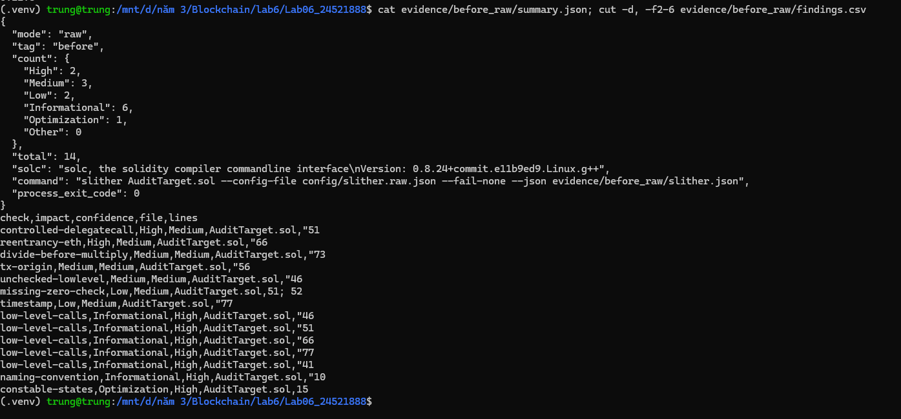

Với cùng mã nguồn, chế độ configured (Hình 3) chỉ còn 6 finding. Phần bị lọc là Low và Informational, còn 2 High và 3 Medium vẫn giữ nguyên, khớp với nhận xét so sánh ở trên.

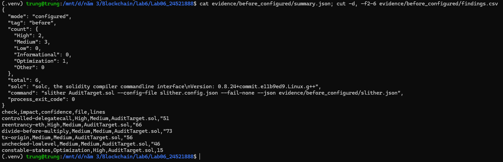

---

## 2. Triage và sửa lỗi (2,5 điểm)

Đọc toàn bộ `AuditTarget.sol` và xác định **4 mẫu lỗi thật** (delegatecall, tx-origin, unchecked low-level call, divide-before-multiply) cùng **2 đoạn cần đánh giá theo ngữ cảnh** (reentrancy có mutex, timelock dùng timestamp). Cả 6 mẫu đều được Slither báo, nên không có mục nào phải ghi "Manual review / Not reported".

| Detector + vị trí | TP / FP / Chưa kết luận | Bằng chứng kiểm soát/khả năng khai thác | Biện pháp (Fix / Accept có lý do) | Sau sửa |
|---|---|---|---|---|
| controlled-delegatecall, `forward()` L51–54 | **TP** | `external`, không có modifier, `target` và `data` do người gọi kiểm soát, nên kẻ tấn công ghi được bất kỳ storage slot nào | **Fix**: xóa hẳn `forward()` vì contract không cần chức năng plugin | Không còn finding (kèm `missing-zero-check` L52) |
| tx-origin, `transferControl()` L56–60 | **TP** | Xác thực bằng `tx.origin` cho phép tấn công phishing qua contract trung gian | **Fix**: bỏ `require(tx.origin…)`, dùng modifier `onlyOwner` (kiểm tra `msg.sender`) và thêm event `OwnerChanged` | Không còn finding |
| unchecked-lowlevel, `flush()` L46–49 | **TP** | Giá trị trả về của `call` bị bỏ qua, nên lỗi chuyển ETH bị "nuốt" mất | **Fix**: `(bool ok,) = to.call…; require(ok, "flush failed")` | Chỉ còn `low-level-calls` (Informational) |
| divide-before-multiply, `previewFee()` L73–75 | **TP** | `amount / 10000 * 250` mất phần dư (amount < 10000 thì phí = 0) | **Fix**: `amount * feeBps / 10000`. Solidity 0.8 có kiểm tra tràn số nên không lo overflow. Đổi `feeBps` thành `constant` và hàm thành `pure` | Không còn finding (kèm `constable-states`) |
| reentrancy-eth, `claimSafe()` L66–71 | **FP theo ngữ cảnh** (severity High nhưng risk thấp) | Modifier `guarded` đặt `locked = true` trước thân hàm, nên mọi lần gọi lại `claimSafe`/`depositSafe` đều revert `"reentrant"`. Gọi chéo sang `contribute()` chỉ ghi vào mapping `balances` khác, không ảnh hưởng `escrowed` | **Fix phòng ngừa**: áp dụng Checks-Effects-Interactions, đặt `escrowed[msg.sender] = 0` trước khi `call`, để code an toàn kể cả khi sau này bỏ mutex | Không còn finding |
| timestamp, `vestStep()` L77–82 | **Accepted** | Chỉ owner gọi. `block.timestamp` dùng làm mốc khóa 1 ngày, validator chỉ lệch vài giây, không dùng làm nguồn ngẫu nhiên hay quyết định ai nhận tiền | **Accept**: giữ nguyên, không cần suppression vì là Low và đã bị config lọc (không ảnh hưởng gate Medium) | Còn 1 Low trong `after_raw` |

**Kết quả before/after:**

| Chế độ | High | Medium | Low | Info | Opt | Tổng |
|---|---|---|---|---|---|---|
| before_raw | 2 | 3 | 2 | 6 | 1 | 14 |
| before_configured | 2 | 3 | 0 | 0 | 1 | 6 |
| after_raw | 0 | 0 | 1 | 5 | 0 | 6 |
| after_configured | 0 | 0 | 0 | 0 | 0 | **0** |

- **Kịch bản khai thác TP (F01 – delegatecall):** Kẻ tấn công deploy contract `Evil` có hàm `pwn()` ghi `owner` (slot 0) thành địa chỉ của mình -> gọi `SavingsClub_1888.forward(Evil, abi.encodeCall(Evil.pwn,()))`. Không có check quyền nên `delegatecall` chạy `pwn()` trong context storage của SavingsClub -> `owner` bị thay -> kẻ tấn công gọi `ownerWithdraw(address(this).balance)` để rút sạch ETH của mọi người gửi.
- **Kịch bản khai thác TP (F03 – tx-origin):** Kẻ tấn công gửi cho owner một "airdrop" là contract `Phish`. Owner gọi `Phish.claim()`, bên trong gọi `transferControl(attacker)`. Lúc này `msg.sender = Phish` nhưng `tx.origin = owner`, nên check cũ vẫn đúng -> mất quyền owner.
- **Finding severity cao nhưng risk thực tế không tương ứng:** `reentrancy-eth` (High) ở `claimSafe()`. Slither không mô hình hóa mutex trong modifier `guarded`, nên vẫn thấy mẫu "call trước, ghi state sau". Trên đường gọi hiện tại, mọi lần reentry vào hàm có `guarded` đều revert, và hàm không có `guarded` (`contribute`) không đụng tới `escrowed`, nên không rút trùng được. Mình vẫn sửa theo CEI vì chi phí thấp và loại bỏ phụ thuộc vào mutex.
- **Bằng chứng:** `git diff 44e93f1 6a41891 -- AuditTarget.sol` (ảnh bên dưới), `evidence/before_*` và `evidence/after_*`. Các cảnh báo còn lại trong `after_raw`:
  - `timestamp` (Low, `vestStep`): đã accept ở trên.
  - `low-level-calls` ×4 (Info): `call{value:}` có kiểm tra `ok` là cách chuyển ETH được khuyến nghị (không bị giới hạn 2300 gas như `transfer`).
  - `naming-convention` (Info): tên contract `SavingsClub_1888` do generator đặt theo MSSV, giữ nguyên để khớp `lab_identity.json`.
- **`slither-disable-next-line`:** **không dùng.** Tất cả High/Medium được xử lý bằng sửa code. Workflow không bị chỉnh, không bật `exclude_medium`/`exclude_high`.

Hình 4 là phần thay đổi giữa commit baseline và commit sửa lỗi. Các dòng đỏ là code cũ bị bỏ: hàm `forward()`, check `tx.origin`, lệnh `call` không kiểm tra kết quả, và phép chia trước nhân. Các dòng xanh là code mới: `onlyOwner`, `require(ok, ...)`, cập nhật số dư trước khi gọi ra ngoài, và `amount * feeBps / 10000`.

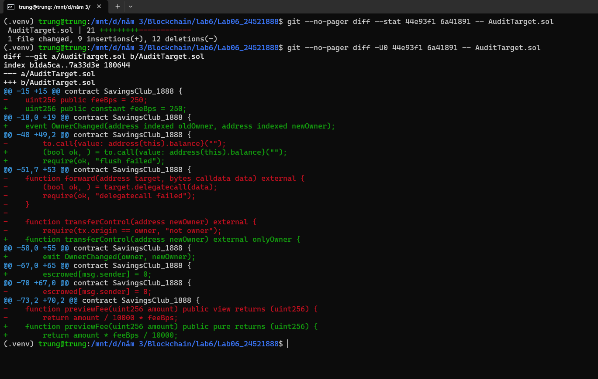

Sau khi sửa, mình quét lại cả hai chế độ (Hình 5). Bản raw không còn High hay Medium, chỉ còn 1 Low (`timestamp`, đã accept) và 5 Informational. Bản configured về 0 finding, nghĩa là CI sẽ không còn gì để chặn.

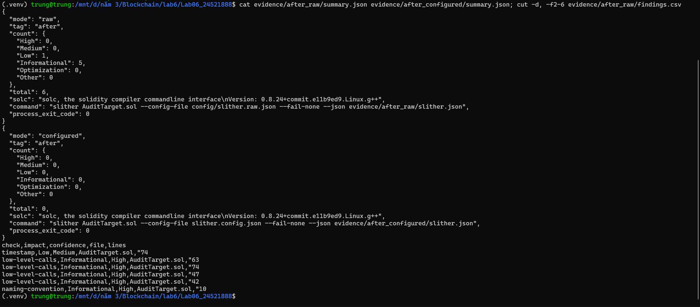

---

## 3. Kiến trúc / Inheritance (1,5 điểm)

- Lệnh printer đã chạy: `python tools/print_arch.py`, tức là chạy hai lệnh
  `slither contracts/ArchitectureDemo.sol --print human-summary` và `slither contracts/ArchitectureDemo.sol --print inheritance-graph`.
  Với Slither 0.11.6, file DOT được sinh ra có tên `ArchitectureDemo.sol.inheritance-graph.dot` (script tìm `ArchitectureDemo.sol.dot`), nên mình copy thành `evidence/architecture/ArchitectureDemo.sol.dot` rồi render:
  `dot -Tpng evidence/architecture/ArchitectureDemo.sol.dot -o evidence/architecture/inheritance.png`
- Kết quả human-summary (`evidence/architecture/human_summary.txt`): 3 contract, 23 SLOC, `StudentAsset` có 4 hàm, 0 High/Medium/Low, 1 optimization.

Hình 6 là đồ thị kế thừa do printer `inheritance-graph` sinh ra, render bằng Graphviz. Mũi tên đi từ contract con sang contract cha, số trên mũi tên là thứ tự kế thừa.

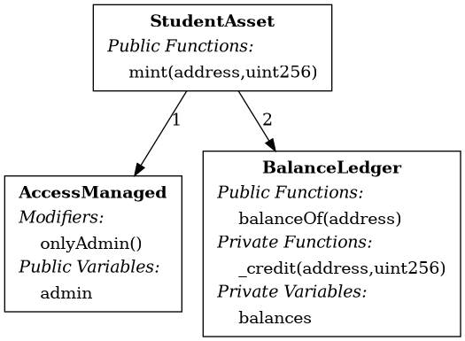

Theo yêu cầu đánh dấu node, mình tô màu và gắn nhãn vai trò cho từng contract trên cùng đồ thị (Hình 7, file `inheritance_annotated.dot` và `.png`). Đỏ là contract quản lý quyền, xanh lá là contract quản lý mapping số dư, xanh dương là contract được gọi từ bên ngoài. Node và cạnh giữ nguyên như output của Slither, chỉ thêm màu và nhãn.

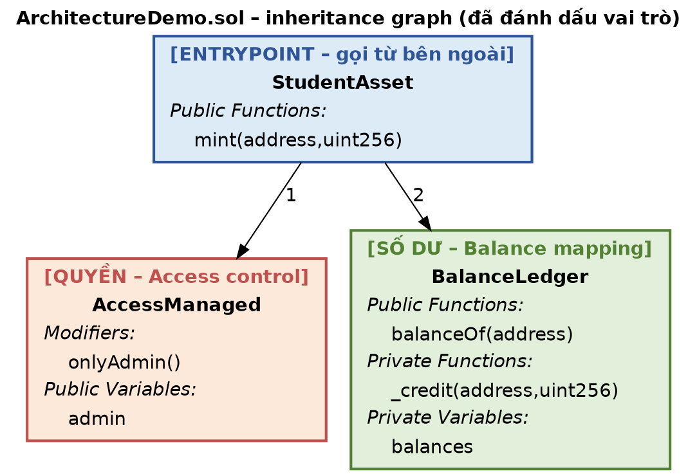

- **Access control** nằm ở `AccessManaged` (biến `admin`, modifier `onlyAdmin()`). **Logic số dư** nằm ở `BalanceLedger` (mapping private `balances`, `_credit()` private, `balanceOf()` public). **Contract triển khai / entrypoint** là `StudentAsset` (kế thừa `AccessManaged` [1] và `BalanceLedger` [2], hàm public `mint(address,uint256)`).
- **Điểm audit cần bắt đầu:** Audit nên bắt đầu từ `StudentAsset.mint()` vì đây là entrypoint duy nhất có thể gọi từ bên ngoài và làm thay đổi số dư. Từ `mint`, cần lần ngược lên hai contract cha: `onlyAdmin` trong `AccessManaged` quyết định ai được mint, còn `_credit` trong `BalanceLedger` quyết định số dư được cộng thế nào. Lỗi security-critical thường nằm ở contract cha (modifier sai, biến `admin` không được khởi tạo hay không có hàm đổi admin an toàn) nhưng chỉ lộ ra qua entrypoint ở contract con. Thứ tự kế thừa (C3 linearization) cũng cần được kiểm tra để chắc chắn không có hàm hay modifier nào bị override ngoài ý muốn.

---

## 4. Red -> Green CI (2,5 điểm)

| Phase | Commit (full/short SHA) | Run URL | Kết quả | Detector khiến RED / lý do GREEN |
|---|---|---|---|---|
| Baseline vulnerable | `44e93f113b67293769efea87e9eeeabc6591038e` (44e93f1) | https://github.com/Trung949/Lab06_24521888/actions/runs/44664351227 | **RED** | 6 result(s): `controlled-delegatecall`, `reentrancy-eth` (High); `tx-origin`, `unchecked-lowlevel`, `divide-before-multiply` (Medium); `constable-states` (Opt) |
| Patched | `6a41891bcb91928b8eaac176caaa8e97db481522` (6a41891) | https://github.com/Trung949/Lab06_24521888/actions/runs/44665000534 | **GREEN** | `0 result(s) found`: mọi High/Medium đã được sửa bằng code, không suppression |

- **So sánh local `--fail-none` với CI `fail-on: medium`:** Ở local, `scan.py` chạy Slither với `--fail-none`, nên exit code luôn là 0 dù có finding. Mục đích là luôn ghi được JSON/CSV làm bằng chứng, exit 0 **không** có nghĩa contract an toàn. Trên CI, `crytic/slither-action` đặt `fail-on: medium`: chỉ cần còn một finding Medium hoặc High (sau khi áp config) là job fail và chặn merge. Đây là quality gate thật.
- **`exclude_low/informational`:** Hai tùy chọn này loại Low và Informational khỏi kết quả hiển thị và JSON (raw 14 -> configured 6 ở before, raw 6 -> configured 0 ở after). Gate không đổi vì `fail-on: medium` vốn đã bỏ qua Low và Info, nhưng log CI gọn hơn và dễ đọc hơn. Config **không** loại High/Medium, nên baseline vẫn RED.

Log Slither gốc của từng run (tải bằng `gh run view <id> --log`) được lưu ở `evidence/ci_logs/`.

Hình 8 là trang tổng quan của run baseline: trạng thái Failure, commit 44e93f1, job `audit` thất bại.

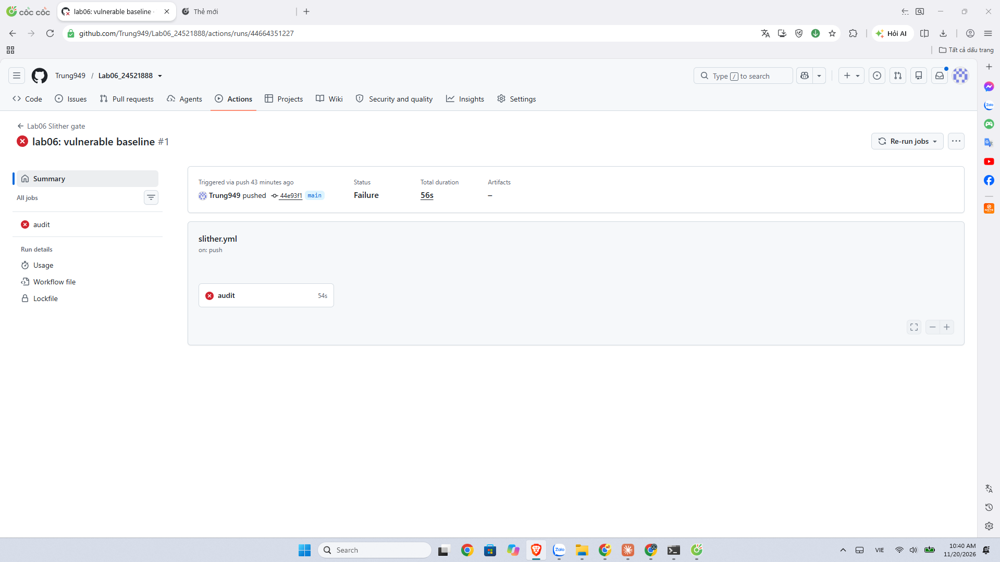

Để chắc chắn RED là do finding chứ không phải lỗi môi trường, mình mở log của step Slither (Hình 9). Log liệt kê đúng các detector `controlled-delegatecall`, `reentrancy-eth`, `divide-before-multiply`, `tx-origin`, `unchecked-lowlevel` và kết thúc bằng `6 result(s) found`.

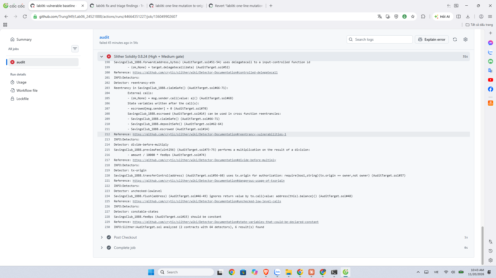

Sau khi push bản sửa, run tiếp theo chuyển sang Success tại commit 6a41891 (Hình 10).

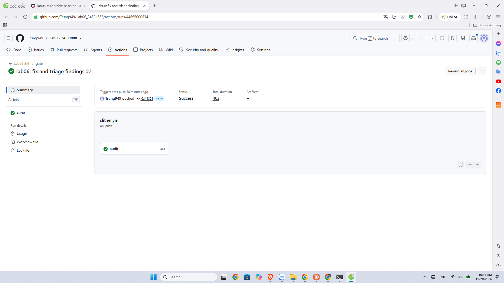

---

## 5. Mutation RED -> GREEN (1,5 điểm)

### 5.1. Mutation theo đề, trong `modifier onlyOwner`

- Mutation một dòng: `require(msg.sender == owner, "not owner")` -> `require(tx.origin == owner, "not owner")` trong `modifier onlyOwner` (dòng 22).
- Detector kỳ vọng: `tx-origin` (Medium). **Kết quả thực tế từ CI: GREEN, `0 result(s) found`.**

| Phase | Commit SHA | Run URL | Kết quả |
|---|---|---|---|
| Mutation (modifier) | `8e689d29c04b2172f2ca90f67ce0bc2cb57f7518` (8e689d2) | https://github.com/Trung949/Lab06_24521888/actions/runs/44665128204 | GREEN (không như kỳ vọng) |
| Revert mutation | `f549bede88d65e5b5949313cbdabf549313c1964` (f549bed) | https://github.com/Trung949/Lab06_24521888/actions/runs/44665331270 | GREEN |

- **Phân tích nguyên nhân:** Đọc mã nguồn detector `slither/detectors/statements/tx_origin.py` (Slither 0.11.6), hàm `detect_tx_origin` chỉ duyệt `for f in contract.functions` và không duyệt `contract.modifiers`. Vì vậy `tx.origin` nằm trong modifier không bị phát hiện. Kiểm chứng ở local bằng `slither AuditTarget.sol --detect tx-origin` cũng cho `0 result(s)`. Đây là **false negative** của tool: lỗi vẫn tồn tại (mọi hàm `onlyOwner` đều có thể bị phishing), chỉ là CI không bắt được. Bài học là phân tích tĩnh không thay thế được manual review.

### 5.2. Mutation bổ sung một dòng, đặt trong hàm

Để chứng minh gate hoạt động với `tx-origin`, mình đổi **một dòng** trong `transferControl()` (dòng 54): `require(newOwner != address(0), "zero");` -> `require(tx.origin == owner, "not owner");`.

| Phase | Commit SHA | Run URL | Kết quả |
|---|---|---|---|
| Mutation (function) | `0c112a74fd51a9321529b8d2411e8c92ba6d9723` (0c112a7) | https://github.com/Trung949/Lab06_24521888/actions/runs/44666602876 | **RED**, `Detector: tx-origin`, 1 result(s) |
| Revert mutation | `be06d84cda1775dde6ce97936bd66c3077d2786b` (be06d84) | https://github.com/Trung949/Lab06_24521888/actions/runs/44666736367 | **GREEN**, 0 result(s) |

- **Thay đổi về nguồn định danh / authorization:** `msg.sender` là địa chỉ **gọi trực tiếp** hàm hiện tại, nên chỉ đúng khi chính owner (EOA hoặc contract owner) gọi vào. `tx.origin` là EOA **khởi tạo giao dịch**, giữ nguyên qua mọi lớp gọi trung gian. Khi chuyển check sang `tx.origin`, bất kỳ contract nào owner tương tác cũng có thể gọi lại vào hàm được bảo vệ "thay mặt" owner, tức authorization chuyển từ "ai đang gọi" sang "ai ký giao dịch". Ngoài ra, nếu owner là multisig hoặc smart wallet thì `tx.origin` không bao giờ bằng `owner`, nên hàm bị khóa vĩnh viễn.

Hình 11 là run của commit mutation 0c112a7: CI chuyển sang Failure ngay sau khi chỉ đổi một dòng.

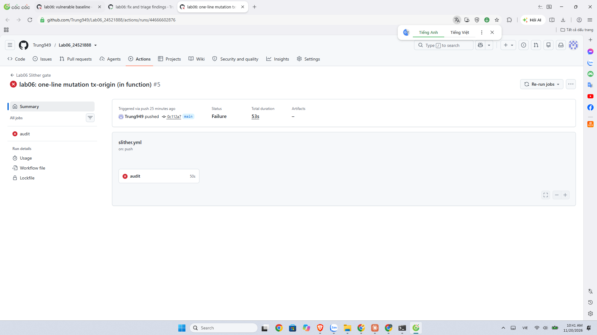

Log của step Slither (Hình 12) cho thấy nguyên nhân là đúng một finding `tx-origin` tại `transferControl` (AuditTarget.sol#54), tổng `1 result(s) found`.

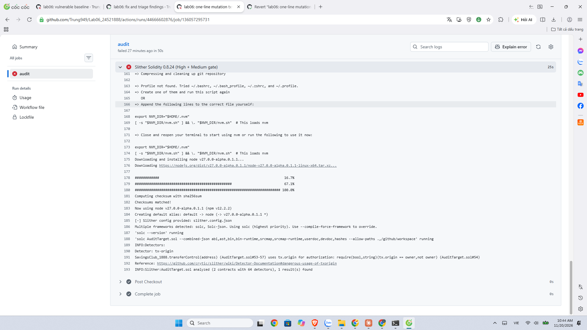

Sau khi `git revert`, run cuối cùng quay lại Success tại commit be06d84 (Hình 13). Như vậy branch `main` kết thúc ở trạng thái an toàn.

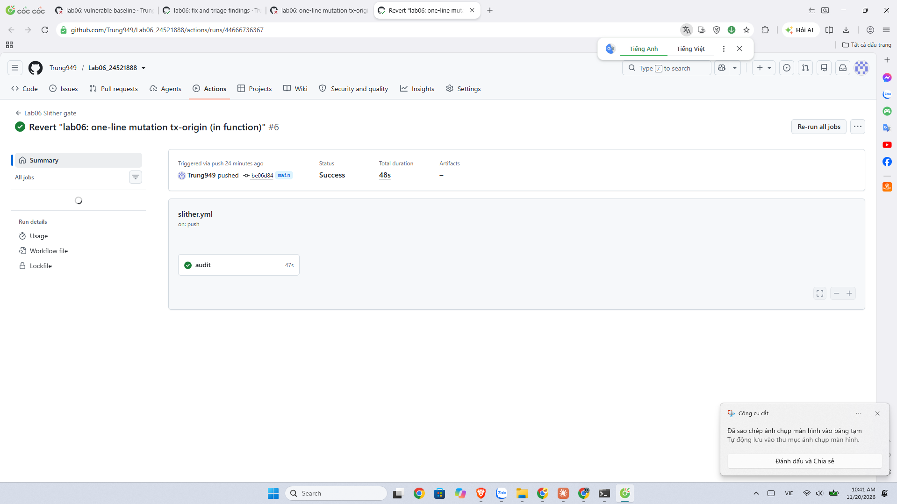

**Chuỗi CI đầy đủ (R-G-R-G):** 44e93f1 RED -> 6a41891 GREEN -> 0c112a7 RED (tx-origin) -> be06d84 GREEN. Branch `main` cuối cùng ở trạng thái GREEN.

---

## 6. Bằng chứng, tự kiểm

- [x] `AuditTarget.sol`, `lab_identity.json`
- [x] `evidence/before_raw/` và `evidence/before_configured/`
- [x] `evidence/after_raw/` và `evidence/after_configured/`
- [x] `evidence/architecture/` (human_summary.txt, .dot, inheritance.png)
- [x] 04 URL Actions run RED/GREEN/RED/GREEN + 04 commit SHA (thêm 1 cặp mutation trong modifier ở mục 5.1)
- [x] Link repo và ảnh màn hình có terminal / URL / commit SHA; không cắt mất ngữ cảnh
- [x] Các finding được triage, không chép lại mô tả detector thay cho suy luận
- [x] Tuyệt đối không có seed phrase, private key, credentials

**Nhận xét cuối cùng:** Slither phát hiện nhanh 5 mẫu High/Medium trên contract cá nhân, nhưng kết quả cần được triage theo ngữ cảnh: `reentrancy-eth` bị báo High dù mutex `guarded` đã chặn reentry. Ngược lại, tool cũng có false negative: `tx.origin` đặt trong modifier không bị detector 0.11.6 phát hiện, cho thấy CI xanh không đồng nghĩa với code an toàn. Các lỗi thật được sửa tận gốc (xóa delegatecall tùy ý, xác thực bằng `msg.sender`, kiểm tra kết quả `call`, nhân trước chia sau) thay vì suppression hay nới config. Quality gate `fail-on: medium` trên GitHub Actions biến kết quả phân tích tĩnh thành điều kiện chặn, thể hiện qua chuỗi RED -> GREEN -> RED -> GREEN. Printer inheritance-graph giúp xác định entrypoint và các contract cha chứa logic quyền và số dư, từ đó khoanh vùng audit hiệu quả hơn. Quy trình phù hợp là kết hợp CI tự động với manual review và kiểm thử.
